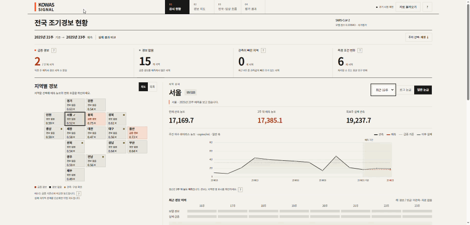
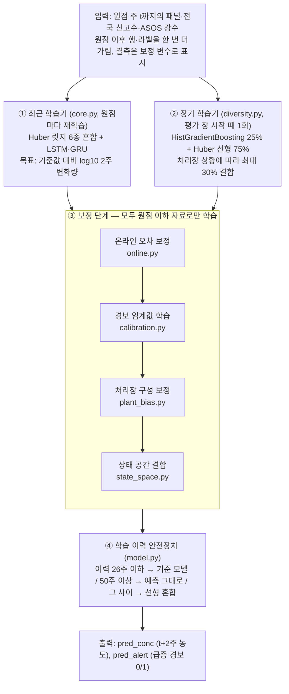
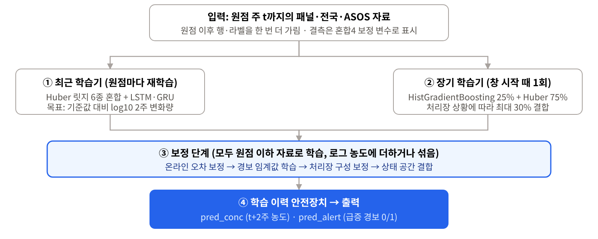
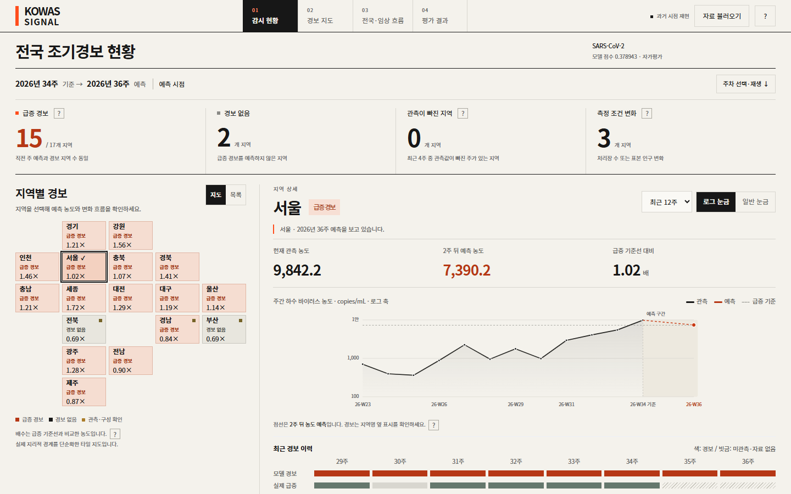
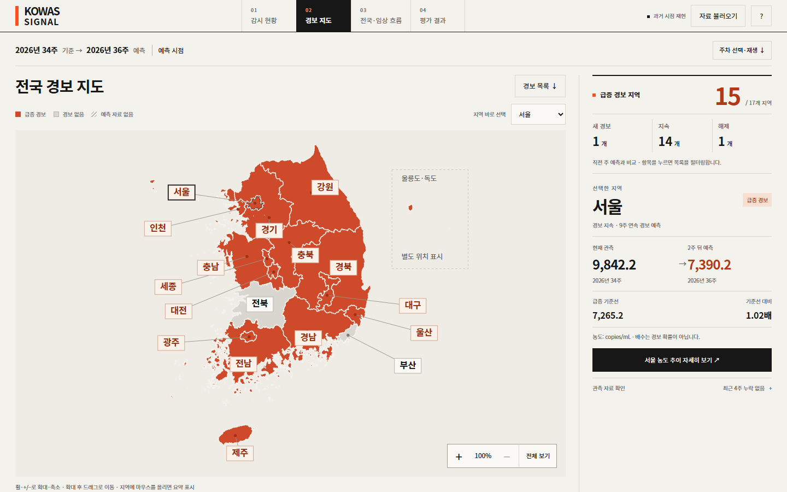
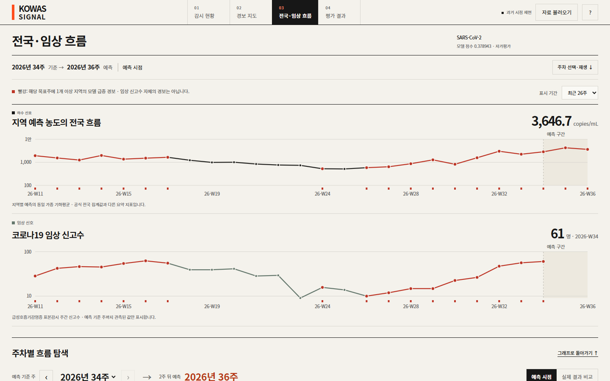
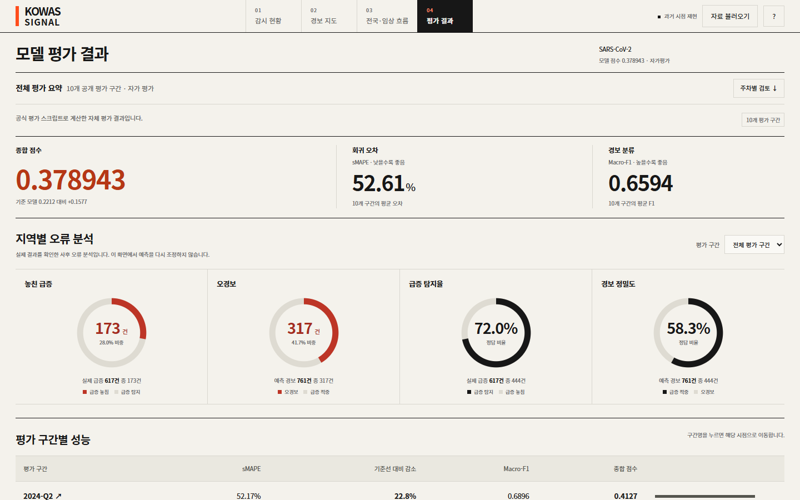
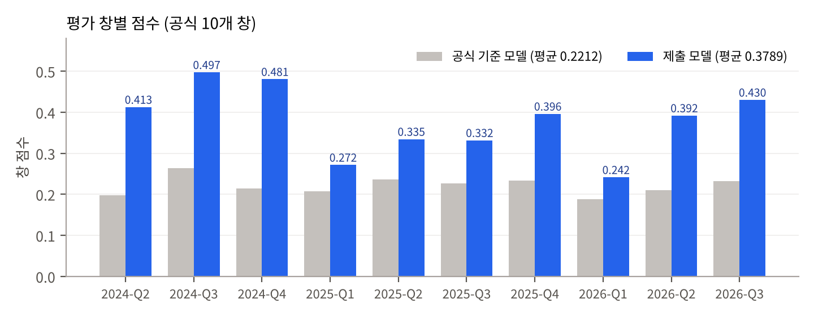
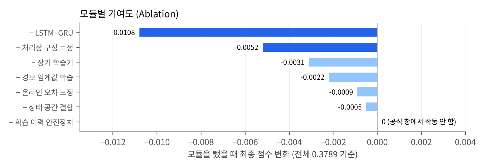
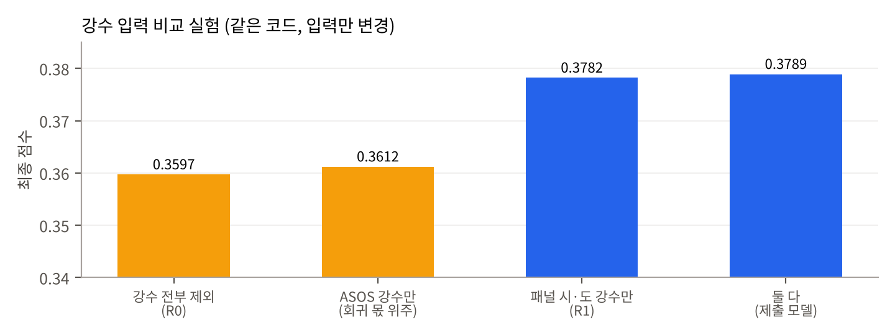

# KOWAS-EPI 하수 감시 기반 감염병 조기경보 모델

하수 감시(KOWAS) 주간 데이터로 **17개 시·도의 2주 뒤 SARS-CoV-2 하수 농도와 급증 경보**를 예측하는 모델입니다.
2026 DATA·AI 분석 경진대회 「하수 감시 데이터 기반 감염병 유행 조기예측 AI 모델 개발」(KISTI AIDA) 출품작이며, **The사랑해팀**(4인)이 만들었습니다.

[](https://www.python.org/)
[](https://numpy.org/)
[](https://scikit-learn.org/)

<p align="center">
  <a href="demo/KOWAS_demo.mp4"></a><br>
  <sub>▶ <a href="demo/KOWAS_demo.mp4"><b>전체 시연 영상 보기 (2분 31초)</b></a> · 위 화면은 영상 전체를 2.5초 간격으로 뽑아 이은 약 21초 미리보기입니다</sub>
</p>

## 한눈에 보기

| 항목 | 값 |
|---|---|
| 예측 대상 | 시·도 17곳의 **t+2주 하수 농도**(`pred_conc`)와 **급증 경보**(`pred_alert`, 원점 직전 4주 평균의 1.3배 이상) |
| 최종 점수 (공식 평가 창 10개, 데이터 v2.5) | **0.3789** (0.37894). 공식 기준 모델 0.2212 |
| 평균 sMAPE | 52.6% (기준 모델 66.1%) |
| 평균 Macro-F1 | 0.659 (기준 모델 0.553) |
| 기준 모델 대비 | 10개 창 모두 기준 모델 이상 |
| 실행 환경 | CPU 1코어, 평가 창 10개 합계 약 18~34분. 외부 AI 서비스·API 없이 네트워크 없이 실행 |
| 라이브러리 | numpy, scikit-learn (노트북에만 matplotlib, notebook). 딥러닝 프레임워크 없이 LSTM·GRU를 numpy로 구현 |

창별 점수 = 0.6 × (1 − sMAPE / 기준선 sMAPE) + 0.4 × Macro-F1 이며, 평가 창 10개(2024-Q2 ~ 2026-Q3)를 같은 비중으로 평균합니다.

## 문제와 접근

하수 농도는 감염 유행을 임상 신고보다 먼저 보여 주는 보조 지표지만, 주간 농도의 증감만으로는 다음 방향을 판단하기 어렵습니다. 관측 공백, 채취 처리장 구성의 변화, 강수에 따른 희석이 집계 농도에 함께 섞이기 때문입니다.

- 시·도마다 농도 규모가 크게 달라서 **기준값 대비 log10 2주 변화량**을 학습 목표로 삼았습니다.
- 최근 관측에 민감한 모델(Huber 릿지, LSTM·GRU)과 장기 이력을 쓰는 트리 모델을 결합했습니다.
- 이미 정답이 관측된 과거 예측으로 오차와 경보 임계값을 보정했습니다.
- 관측 공백과 처리장 구성 변화는 별도의 변수와 보정 단계로 다뤘습니다.
- **모든 단계는 원점 주 t 이하의 자료만 씁니다.** 평가기가 원점 이후 행과 라벨을 가리고, 모델이 한 번 더 가립니다.

이 모델은 하수 지표를 예측하며 임상 환자 수를 직접 예측하지 않습니다. 경보는 대회의 조작적 정의이고 보건당국의 공식 기준이 아닙니다.

## 예측 파이프라인

원점 주 t마다 아래 순서로 계산합니다. 저장된 가중치는 없고, 평가 창의 원점마다 처음부터 다시 학습합니다.



<p align="center"></p>

| 단계 | 파일 | 하는 일 |
|---|---|---|
| 입력 정리 | `model.py` | 원점 이후 행·라벨을 한 번 더 가립니다. 결측 주의 3주 평균에 다음 주 값이 섞인 알려진 예외는 과거 관측값으로만 다시 계산합니다 |
| ① 최근 학습기 | `core.py` | 학습 기간 78·104·26·39주의 Huber 릿지 6종을 가중 평균하고 LSTM·GRU를 더합니다. 상승·하락 비대칭, 전국 확산, 학습기간 간 의견 차이 감쇠, 작년 같은 시기 변화를 보정합니다 |
| ② 장기 학습기 | `diversity.py` | 평가 창 시작 때까지의 모든 라벨로 한 번 학습합니다. ASOS 강수 특징을 결합합니다 |
| ③-1 온라인 오차 보정 | `online.py` | 과거 원점마다 그 당시 정보만으로 예측을 다시 만들고, t+2 정답이 이미 관측된 표본으로 최근 26주의 오차 보정기를 학습합니다 |
| ③-2 경보 임계값 학습 | `calibration.py` | 최근 13개 발행 주의 과거 경보 여유값과 관측된 경보 정답으로, 부드러운 기대 Macro-F1이 가장 높은 임계값을 고릅니다 |
| ③-3 처리장 구성 보정 | `plant_bias.py` | `n_sites`, `pop_sampled`로 어느 처리장이 채취됐는지 추론하고, 구성이 바뀔 때의 농도 편향을 학습합니다. 같은 시기 전국 변화는 빼서 유행 자체의 변화와 구분합니다 |
| ③-4 상태 공간 결합 | `state_space.py` | 지역 상태, 감쇠 추세, 처리장 편향을 칼만 필터로 분리한 예측을 2.5~20% 섞습니다 |
| ④ 안전장치 | `model.py` | 학습 이력이 짧을 때 기준 모델 쪽으로 물러납니다. 공식 평가 창은 가장 이른 원점도 이력이 51주라 작동하지 않습니다 |

**자료 처리 원칙**
- **이상값은 지우지 않습니다.** 극단값의 영향만 줄입니다(log10 변환, Huber 손실, 일부 모델은 |tanh| 손실, 릿지 규제, 보정량 상한).
- **결측은 불확실성으로 다룹니다.** 마지막 관측값을 이어 쓰고 경과 주수·결측 표시·결측 신뢰도를 변수로 넣습니다. 결측 행의 경보를 끄는 수정은 시험했지만 기각했습니다(아래 "시험했으나 채택하지 않은 것").
- **변수:** 최근 수준·변화, 26주 중앙값 대비 수준, 전국 상대 수준, 강수(패널 주간값과 ASOS 일자료), 전국 신고수 변화, 52주 수준, 처리장 수, 계절성(주차의 sin·cos), 변동성, 결측 신뢰도, 전국 확산(2주 사이 2배 넘게 오른 시·도 비율) 등.

## 시각화 대시보드 (KOWAS SIGNAL)

모델이 낸 2주 뒤 농도와 경보를 지도, 시계열, 평가표로 살펴보는 **단일 HTML 파일**입니다. 인터넷 연결 없이 브라우저로 열면 바로 보이고, 시연 영상의 화면이 이 파일입니다.

- 열기: [`dashboard/KOWAS_signal.html`](dashboard/KOWAS_signal.html)을 내려받아 브라우저로 엽니다 (저장소 화면에서는 HTML이 소스로 보입니다).
- 설명: [`dashboard/README.md`](dashboard/README.md)

<table>
  <tr>
    <td width="50%"></td>
    <td width="50%"></td>
  </tr>
  <tr>
    <td align="center"><b>01 감시 현황</b><br>급증 경보 지역 수, 지역별 경보, 지역 상세 시계열, 최근 경보 이력</td>
    <td align="center"><b>02 경보 지도</b><br>새 경보·지속·해제 지역과 예측 농도</td>
  </tr>
  <tr>
    <td width="50%"></td>
    <td width="50%"></td>
  </tr>
  <tr>
    <td align="center"><b>03 전국·임상 흐름</b><br>전국 예측 농도와 임상 신고수 비교</td>
    <td align="center"><b>04 평가 결과</b><br>종합 점수, sMAPE, Macro-F1, 오류 분석, 구간별 성능</td>
  </tr>
</table>

대시보드의 평가 화면 기준으로 10개 창 전체에서 **실제 급증 617건 중 444건을 탐지(72.0%)**했고, **예측 경보 761건 중 444건이 적중(58.3%)**했습니다. 놓친 급증이 173건, 오경보가 317건이라 경보는 실제 급증보다 다소 많이 내는 편입니다.

> **데이터 안내.** `KOWAS_signal.html`에는 대회 배포 자료의 시·도별 주간 농도값과 모델 예측값이 파일 안에 들어 있습니다(공개 가능 여부는 팀이 확인했습니다, [`dashboard/README.md`](dashboard/README.md)). 대회 배포 **원자료 파일(CSV)과 예측 결과 CSV(`predictions.csv`)는 이 저장소에 없습니다.**

## 성능

### 평가 창 10개

| 평가 창 | sMAPE | 기준선 sMAPE | Macro-F1 | 창 점수 |
|---|---|---|---|---|
| 2024-Q2 | 52.17% | 67.60% | 0.6896 | 0.4127 |
| 2024-Q3 | 63.52% | 90.86% | 0.7924 | 0.4975 |
| 2024-Q4 | 52.40% | 72.76% | 0.7817 | 0.4806 |
| 2025-Q1 | 57.67% | 60.24% | 0.6154 | 0.2717 |
| 2025-Q2 | 48.80% | 56.72% | 0.6272 | 0.3347 |
| 2025-Q3 | 52.02% | 58.35% | 0.6670 | 0.3318 |
| 2025-Q4 | 48.04% | 69.00% | 0.5349 | 0.3963 |
| 2026-Q1 | 54.75% | 56.42% | 0.5597 | 0.2416 |
| 2026-Q2 | 47.07% | 57.62% | 0.7057 | 0.3922 |
| 2026-Q3 | 49.66% | 71.31% | 0.6204 | 0.4303 |
| **평균** | **52.61%** | **66.09%** | **0.6594** | **0.3789** |

<p align="center"></p>

### 개발 과정

| 버전 | 공식 점수 | 바뀐 점 |
|---|---|---|
| 공식 기준 모델 | 0.2212 | 3주 평균 + 현재 경보 지속 |
| 분할 모델(초기) | 0.3324 | Huber 릿지 + LSTM·GRU, 경보 1.0배 판정 |
| 팀 회귀 안정 후보 + 경보 판정 수정 | 0.3555 | 혼합4 결측 보정, 다중 학습기간 혼합, 순환망을 뺀 농도로 경보 판정 |
| v4b | 0.3677 | 모델 혼합·보정값·경보 규칙 재선택 (`core.py`의 기반) |
| **r2_plant_v7 (최종)** | **0.3789** | 온라인 오차 보정, 경보 임계값 학습, 처리장 구성 보정, 상태 공간 결합 |

### 모듈별 기여도 (모듈을 하나씩 뺀 실험)

| 실험 | 점수 | 전체 대비 |
|---|---:|---:|
| 전체 모델 | **0.3789** | — |
| − 온라인 오차 보정 | 0.3780 | −0.0009 |
| − 경보 임계값 학습 | 0.3767 | −0.0022 |
| − 처리장 구성 보정 | 0.3737 | −0.0052 |
| − 상태 공간 결합 | 0.3785 | −0.0005 |
| − 장기 학습기 | 0.3758 | −0.0031 |
| − LSTM·GRU (재학습) | 0.3681 | −0.0108 |
| 코어만 | 0.3675 | −0.0114 |

- 핵심 모듈은 **LSTM·GRU와 처리장 구성 보정**입니다. LSTM·GRU는 주로 경보 쪽에, 처리장 구성 보정은 구성이 자주 바뀐 2026년 창에 기여합니다.
- 온라인 보정(−0.0009)과 상태 공간 결합(−0.0005)은 기여가 작고 창별로 엇갈려서 다음 버전의 단순화 후보입니다.

<p align="center"></p>

### 강수 입력의 기여 (같은 조건의 비교 실험)

제출 코드는 그대로 두고 입력에서 기상 열만 빼서 공식 10개 창을 다시 돌렸습니다.

| 조건 | 모델에 넣은 기상 입력 | 최종 점수 |
|---|---|---:|
| R0 | 없음 | 0.3597 |
| R1 | 시·도 주간 기상(패널 `precip_mm`·`temp_avg`) | 0.3782 |
| ASOS만 | ASOS 일자료 강수 특징 | 0.3612 |
| **R2 (최종)** | 둘 다 | **0.3789** |

강수를 모두 빼면 −0.019이고 10개 창 중 9개가 내려갑니다. 다만 이 기여의 3분의 2가 경보 쪽(Macro-F1)이어서 "강수가 농도 예측을 크게 개선했다"고 해석하지 않습니다. 시·도 집계에서 약해진 희석 신호를 복원했다는 증거도 아닙니다. 코드와 결과는 [`experiments/rain_ablation/`](experiments/rain_ablation/)에 있습니다.

<p align="center"></p>

### 과적합 점검

조정에 쓰지 않은 기간(2023-Q3, 2023-Q4, 2024-Q1)을 같은 평가기와 규칙으로 추가 평가 창으로 정의해 돌렸습니다.

| 모델 | 공식 10개 창 | 추가 3개 창 |
|---|---|---|
| 공식 기준 모델 | 0.2212 | 0.2226 |
| 안전장치 없는 r2_plant_v7 | 0.3789 | 0.1076 |
| 공식 창에 더 맞춘 결합본(v4e 코어) | 0.3793 | 0.0848 |
| **최종 모델 (안전장치 포함)** | **0.3789** | **0.1774** |

- 공식 창에서 0.0004 더 높던 결합본은 추가 기간에서 0.023 낮았습니다. 공식 창에 과하게 맞춘 조정으로 보고 **채택하지 않았습니다.**
- 추가 기간은 학습 이력이 10~50주뿐이라 모든 학습 모델이 기준 모델보다 낮았습니다. 그래서 학습 이력 안전장치를 넣었습니다. 안전장치의 26·50주 값은 이 기간을 본 뒤 정했으므로 0.1774는 참고치입니다.
- 공개 10개 창은 설정 선택에 반복 사용되었고, 선택 단계마다 0.002~0.004가 부풀 수 있습니다. 학습 이력이 1년 이상인 새 기간의 기대 성능은 약 0.37로 봅니다(추정치).

### 시험했으나 채택하지 않은 것

- **결측 원점의 경보를 끄는 수정:** 오경보 20건이 줄었지만 실제 급증을 18건 더 놓쳐 점수가 0.37894 → 0.37749로 내려갔습니다. 관측이 없다는 것은 위험이 없다는 뜻이 아니므로 기각했습니다.
- **공개 창에서의 추가 조정:** 선택 단계마다 점수가 부풀 수 있어 중단했습니다.
- **2025-Q1 약점의 단일 원인 주장:** 결측과 처리장 구성 변화가 함께 나타났지만 다른 요인을 배제하지 못해 철회했습니다([`docs/REVIEW.md`](docs/REVIEW.md)).

## 새 병원체에 쓸 수 있나

코드에 병원체를 지정하거나 거르는 부분이 없고, 학습기가 평가 창마다 처음부터 다시 학습하므로 재학습만으로 적용할 수 있게 설계했습니다. 같은 평가기와 같은 10개 창으로 두 가지를 흉내 내 실행했습니다.

| 시험 | 최종 점수 | 결과 |
|---|---:|---|
| 원래 자료 | 0.3789 | — |
| 모든 농도 ×100 (단위가 다른 병원체 가정) | 0.3789 | 예측 농도가 정확히 약 100배로 따라가고 경보 2,159행이 모두 동일 |
| 전국 임상 신고수 열을 모두 비움 | 0.3560 | 오류 없이 실행, 기준 모델(0.2212)보다 크게 높음 |

실제 다른 병원체 자료로는 검증하지 않았습니다(대회 자료에는 SARS-CoV-2만 있음). 혼합 비율·보정값·경보 기준 같은 고정 조정값은 SARS-CoV-2 공개 평가 창으로 골랐기 때문에, 새 병원체에서는 성능을 먼저 확인해야 합니다.

## 한계

- 유행 자체의 변화, 채취 처리장 구성 변화, 강수 희석의 효과를 서로 분리했음을 입증하지 못했습니다. 처리장 구성은 `n_sites`·`pop_sampled`로 추론한 신호이고 실제 채취 조합과 같다고 보장할 수 없습니다.
- 취약 창(2025-Q1, 2026-Q1)은 기준선과 비슷한 수준입니다. 결측과 구성 변화가 함께 나타났지만 원인을 하나로 단정하지 않습니다.
- 주간 잡음이 큽니다. 2주 사이 3배 이상 급변(전체 행의 약 22%)이 오차의 약 41%를 차지합니다.
- 학습 이력이 1년 미만이면 기준 모델보다 약해서 안전장치로 기준 모델 쪽으로 물러납니다.
- 평가 기간 이후 성능과 실시간 공표 지연을 반영한 성능은 보장하지 않습니다.
- 전국 예측과 임상 신고수의 log10 상관은 0.94(127주)였지만, 임상 신고수가 모델 입력에도 들어가므로 선행 정보를 입증하는 값이 아닙니다. 사건 단위의 실효성 검증은 아직 하지 않았습니다.

## 저장소 구조

```
kowas-epi-early-warning/
├── model.py                  # 진입점(Model 클래스), 학습 이력 안전장치
├── core.py                   # ① 최근 학습기 (Huber 릿지, LSTM·GRU)
├── diversity.py              # ② 장기 학습기 (HistGradientBoosting + 선형)
├── online.py  calibration.py  plant_bias.py  state_space.py     # ③ 보정 단계
├── requirements.txt          # 버전 범위 (3.11 이상 설치용, 3.11에서 실행은 미검증)
├── requirements-lock.txt     # 검증 환경의 정확한 버전 (Python 3.12 이상용)
├── requirements-notebook.txt
├── score.json                # 공식 평가 창 10개 결과
├── scripts/                  # 환경 설치, 백테스트 실행, 형식 검증
├── notebooks/                # 학습·평가 노트북 (실행 결과 포함)
├── dashboard/                # KOWAS SIGNAL 대시보드(HTML)
├── demo/                     # 시연 영상(mp4)과 README용 미리보기(gif)
├── figures/                  # 결과 그림 4장
├── experiments/rain_ablation # 강수 비교 실험
└── docs/                     # 보고서·설명서(PDF), 제출 README, 기여도 분석, 실행 기록
```

코드 7개가 루트에 있는 이유는 평가기가 `model.py`가 있는 폴더를 모듈 검색 경로로 쓰기 때문입니다.

## 실행하기

모델을 돌리려면 **KOWAS-EPI v2.5 대회 배포 자료와 평가기(`evaluation.py`)**가 필요하며, 대회 목적으로만 쓸 수 있는 자료라 이 저장소에는 없습니다. 배포 자료가 있다면 아래처럼 실행합니다.

```bash
bash scripts/setup_env.sh                                 # .venv 생성 + requirements.txt 설치
bash scripts/run_backtest.sh <KOWAS-EPI 배포 폴더> 2024-Q2 # 평가 창 1개 (약 1분)
bash scripts/run_backtest.sh <KOWAS-EPI 배포 폴더>         # 전체 10개 창 (약 20~35분)
```

Windows는 같은 이름의 `.ps1` 스크립트를 씁니다. 결과는 `results/`에 저장됩니다. 자세한 실행 방법, 검증 환경, 점검 기록은 [`docs/RUN.md`](docs/RUN.md)에 있습니다.

**재현성:** 난수 시드를 고정했고, 같은 환경에서 두 번 실행한 예측 파일이 바이트 단위로 같았습니다. 같은 점수를 Windows(Python 3.13.14, NumPy 2.5.2)에서 0.37896, Linux(Python 3.13.16, NumPy 2.5.3)에서 0.37894로 얻었습니다. 버전이나 운영체제가 다르면 농도 예측이 소수 자리에서 조금 달라질 수 있습니다.

## 규정 준수

대회 규정에 맞춰 만들었고, 점검 내용은 [`docs/SUBMISSION.md`](docs/SUBMISSION.md) 9절에 있습니다.

- 자료는 평가기가 넘겨 주는 `rows`·`national`·`aux` 인자로만 받고, 허용된 정적 파일(`plant_meta.csv`, `asos_stations.csv`)만 읽습니다.
- 학습 가중치와 KOWAS 수치를 코드에 넣지 않았습니다. 특정 주차·연도·지역 조건문도 없습니다.
- 원점 이후 값(패널·전국·기상·정답)을 바꿔도 예측이 변하지 않는 것을 확인했습니다.
- 외부 자료는 대회 배포 자료(질병관리청 KOWAS, 급성호흡기감염증 표본감시, Open-Meteo CC BY 4.0, 기상청 ASOS)만 썼습니다.

## 생성형 AI 활용

개발과 문서 작성에 OpenAI ChatGPT·Codex, Anthropic Claude를 썼습니다. 예측 모델 자체는 생성형 AI를 호출하지 않습니다. 활용 단계, 팀의 검증 방식, 검토한 대안과 실패 사례는 [`docs/AI_활용내역.pdf`](docs/AI_활용내역.pdf)와 [`docs/SUBMISSION.md`](docs/SUBMISSION.md) 15절에 있습니다. AI가 낸 수정안의 채택·기각은 팀이 결정했고, 결과는 공식 평가기로 다시 계산해 검증했습니다.

## 팀 작업 방식

The사랑해팀(4인)이 공식 기준 모델(베이스라인)에서 출발해, 팀원 각자가 설계·실험한 방식을 비교하고 **각자의 장점을 합쳐 하나의 최종 모델**을 만들었습니다. 위 "개발 과정" 표의 버전이 그 흐름입니다.

- **팀원 각자의 작업:** 결측 보정(혼합4)과 특징 설계, 회귀 안정 후보, 2차 자율 연구(온라인 오차 보정, 경보 임계값 학습, 처리장 구성 보정, 상태 공간 결합)
- **팀 공동 작업:** 최근 학습기 코어(v4b), 최종본의 과적합 점검, 학습 이력 안전장치

출처는 [`docs/SUBMISSION.md`](docs/SUBMISSION.md) 13절입니다.

## 문서

| 문서 | 내용 |
|---|---|
| [`docs/문제해결_설명서.pdf`](docs/문제해결_설명서.pdf) | 대회 제출용 문제해결 방법 설명서 (12쪽) |
| [`docs/문제해결_보고서.pdf`](docs/문제해결_보고서.pdf) | 상세 보고서 (18쪽). 개발 과정, 취약 구간 분석, 과적합·누수 점검, 임상 흐름 사후 비교 |
| [`docs/AI_활용내역.pdf`](docs/AI_활용내역.pdf) | 생성형 AI 활용 범위와 주요 검토 결과 |
| [`docs/SUBMISSION.md`](docs/SUBMISSION.md) | 제출 당시 README (규정 준수, 환경, 출처, 점검표) |
| [`docs/REVIEW.md`](docs/REVIEW.md) | 모듈별 기여도, 취약 창 분석, 기각한 수정안 |
| [`docs/RUN.md`](docs/RUN.md) | 실행 방법과 점검 기록 |

## 대회 정보

- 과제: [하수 감시 데이터 기반 감염병 유행 조기예측 AI 모델 개발](https://aida.kisti.re.kr/competition/main/problem/PROB_000000000004611/detail.do) (2026 DATA·AI 분석 경진대회, KISTI AIDA)
- 팀: The사랑해팀 (4인)
